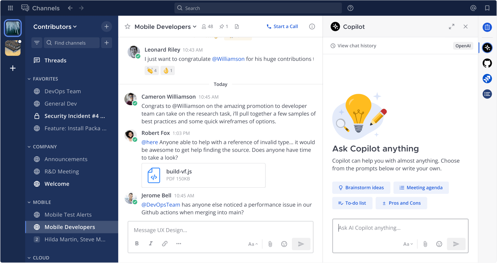

<div align="center">

# Antimatter Agents Plugin [](https://github.com/antimatterchat/antimatter-plugin-agents/releases/tag/latest-master)

The Antimatter Agents Plugin integrates AI capabilities directly into your Antimatter workspace. **Run any local LLM** on your infrastructure or connect to cloud providers - you control your data and deployment.

</div>



## Key Features

- **Multiple AI Assistants**: Configure different agents with specialized personalities and capabilities
- **Thread & Channel Summarization**: Get concise summaries of long discussions with a single click
- **Action Item Extraction**: Automatically identify and extract action items from threads
- **Meeting Transcription**: Transcribe and summarize meeting recordings
- **Semantic Search**: Find relevant content across your Antimatter instance using natural language
- **Smart Reactions**: Let AI suggest contextually appropriate emoji reactions
- **Direct Conversations**: Chat directly with AI assistants in dedicated channels
- **Flexible LLM Support**: Use local models (Ollama, vLLM, etc.), cloud providers (OpenAI, Anthropic, Azure), or any OpenAI-compatible API

## Documentation

Comprehensive documentation is available in the `/docs` directory:

- [User Guide](docs/user_guide.md): Learn how to interact with AI features
- [Admin Guide](docs/admin_guide.md): Detailed installation and configuration instructions
- [Load Testing](docs/load-testing.md): Configure the in-process mock LLM and load-test-ng Agents controller
- [Provider Setup](docs/providers.md): Configuration for supported LLM providers
- [Feature Documentation](docs/features/): Detailed guides for individual features
  - [Channel Summaries](docs/features/channel_summaries.md): Use the **Ask Agents about this channel** button to summarize and analyze channel activity

## Installation

1. Download the latest release from the [releases page](https://github.com/antimatterchat/antimatter-plugin-agents/releases). You can also download the **experimental** [latest master](https://github.com/antimatterchat/antimatter-plugin-agents/releases/tag/latest-master)
2. Upload and enable the plugin through the Antimatter System Console
3. Configure your desired LLM provider settings

### System Requirements

- Antimatter Server v11.9.0+
- PostgreSQL database with pgvector extension for semantic search capabilities
- Network access to your chosen LLM provider

## Quick Start

After installation, complete these steps to get started:

1. Navigate to **System Console > Plugins > Agents**
2. Create an agent and configure it with your LLM provider credentials
3. Set permissions for who can access the agent
4. Open the Agents panel from any channel using the AI icon in the right sidebar
5. Start interacting with your AI assistant

For detailed configuration instructions, see the [Admin Guide](docs/admin_guide.md).

## Integration

### Bridge Client

The plugin provides a Go client library for other Antimatter plugins and the Antimatter server to interact with the AI plugin's LLM Bridge API. This allows you to easily add AI capabilities to your own plugins or server-side features.

See the [Bridge Client README](public/bridgeclient/README.md) for installation and usage instructions.

## Development

### Prerequisites

- Go 1.24+
- Node.js 24.11+
- Access to an LLM provider (OpenAI, Anthropic, etc.)

### Local Setup

1. Setup your Antimatter development environment by following the [Antimatter developer setup guide](https://antimatter.chat/docs/developers/building.html). If you have a remote antimatter server you want to develop to you can skip this step. 

2. Setup your Antimatter plugin development environment by following the [Plugin Developer setup guide](https://antimatter.chat/docs/developers/apps.html).

3. Clone the repository:
```bash
git clone https://github.com/antimatterchat/antimatter-plugin-agents.git
cd antimatter-plugin-agents
```

4. **Optional**. If you are developing to a remote server, setup environment variables to deploy:
```bash
MM_SERVICESETTINGS_SITEURL=http://localhost:8065
AM_ADMIN_USERNAME=<YOUR_USERNAME>
AM_ADMIN_PASSWORD=<YOUR_PASSWORD>
```
(`AM_SERVICESETTINGS_SITEURL`, `AM_ADMIN_TOKEN` and `AM_LOCALSOCKETPATH` are also read; the legacy `MM_` names are still accepted.)

5. Run deploy to build the plugin
```bash
make deploy
```

### Other make commands

- Run `make help` for a list of all make commands
- Run `make check-style` to verify code style
- Run `make test` to run the test suite
- Run `make e2e` to run the e2e tests
- Run `make evals` to run prompt evaluations interactively (with TUI)
- Run `make evals-ci` to run prompt evaluations in CI mode (non-interactive)

### Benchmark Tests

The streaming code has benchmark tests to measure performance and detect regressions:

```bash
# Run all streaming benchmarks
go test -bench=. -benchmem ./llm/... ./streaming/...

# Run specific benchmark
go test -bench=BenchmarkStreamToPost -benchmem ./streaming/...

# Run with CPU profiling
go test -bench=BenchmarkReadAll -cpuprofile=cpu.prof ./llm/...
```

Benchmarks cover:
- `ReadAll()` stream consumption with varying response sizes
- `TokenUsageLoggingWrapper` interception overhead
- `StreamToPost()` full processing pipeline with WebSocket events

### Multi-Provider Evaluation Support

The evaluation system supports testing with multiple LLM providers: OpenAI, Anthropic, and Azure OpenAI. By default, evaluations run against all providers, but you can target specific ones:

```bash
# Run with all providers (default)
make evals

# Run with only Anthropic
LLM_PROVIDER=anthropic make evals

# Run with OpenAI and Azure
LLM_PROVIDER=openai,azure make evals

# Use a specific model
ANTHROPIC_MODEL=claude-3-opus-20240229 make evals
```

See `cmd/evalviewer/README.md` for complete documentation on environment variables and configuration options.

## Feedback and support

Found a bug in the Agents plugin, or missing a feature? Please [open an
issue](https://github.com/AntimatterChat/community/issues/new/choose) in the [Antimatter community
repository](https://github.com/AntimatterChat/community), where the feedback for every part of
Antimatter is gathered. Questions and ideas are welcome in its
[Discussions](https://github.com/AntimatterChat/community/discussions). Please report security
problems privately, as explained in the [security
policy](https://github.com/AntimatterChat/.github/blob/main/SECURITY.md).

## License

This repository is licensed under [Apache-2](./LICENSE.txt).
